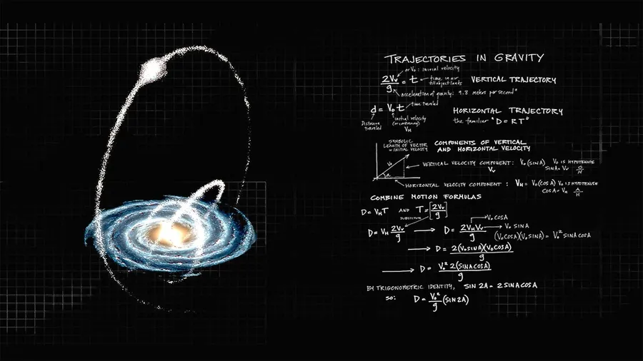

<div align="center">
  
</div>

<br/>

<div align="center">

# Ammaar Bakshi

<a href="https://github.com/AmmaarBakshi">
  
</a>

*"I don't wait to understand everything before I build — I build until I understand everything."*

<br/>

[](https://github.com/AmmaarBakshi)
[](https://pypi.org/project/letx)
[](https://github.com/microsoft/winget-pkgs)
[](https://github.com/AmmaarBakshi)
[](https://user-badge.committers.top/india/AmmaarBakshi)

</div>

---

Every trajectory has equations behind it. Mine runs through pure C, a hand-rolled Rust shell with its own lexer and AST, x86 Assembly written register-by-register, and Python tooling that ships to real package managers. I don't wait for permission to explore a new layer of the stack — if it compiles (or doesn't), I want to know exactly why.

---

## 🛰️ Projects

### [⚗️ oxide](https://github.com/AmmaarBakshi/oxide) &nbsp;`Rust`

A custom, high-performance shell written entirely in Rust — not a wrapper around existing system calls, but a full pipeline built from scratch.

```text
  raw input ──▶ Lexer ──▶ Parser ──▶ AST ──▶ Execution Engine ──▶ output
```

Architected as a Cargo Workspace to keep every layer strictly decoupled:

| Crate | Role |
|---|---|
| `oxide-cli` | Entry point and terminal UI |
| `oxide-core` | REPL loop and state manager |
| `oxide-parser` | Lexer, grammar, and AST generation |
| `oxide-builtins` | Native shell commands (`cd`, `echo`, etc.) |

**Features:** custom lexing & parsing · process execution · output redirection (`>`) · dynamic prompt · built-in command interception

```bash
git clone https://github.com/AmmaarBakshi/oxide.git
cd oxide
cargo run -p oxide-cli
```

<br/>

<table>
<tr>
<td width="50%" valign="top">

### [📅 git-recall](https://github.com/AmmaarBakshi/git-recall) &nbsp;`C`

Personal git standup tool in pure C — no dependencies, just git. See exactly what you committed by day, week, month, or year.

```bash
$ git-recall --week
$ git-recall --month -2   # two months back
$ git-recall --day > recap.txt
```

[](https://github.com/microsoft/winget-pkgs)
[](https://launchpad.net/~ammaar-apt/+archive/ubuntu/git-recall)

</td>
<td width="50%" valign="top">

### [🗡️ paimon](https://github.com/AmmaarBakshi/paimon) &nbsp;`Rust` `JS`

Keyboard-driven Rust TUI that injects code snippets and project structures into your working directory. Snippets are embedded in the binary at compile time — no internet, no Python, nothing extra.

```bash
$ paimon --code -ls
# ↑↓ navigate  ENTER select  ← back  q quit
```

[](https://github.com/microsoft/winget-pkgs)
[](https://www.npmjs.com/package/paimon-npm)

</td>
</tr>
<tr>
<td width="50%" valign="top">

### [🔧 letx](https://github.com/AmmaarBakshi/letx) &nbsp;`Python`

Modular Python CLI toolkit. Plain-English error explanations, fix suggestions, and codebase cleanup — all from the terminal.

```bash
$ letxDebug -a my_script.py  # run + explain + fix
$ letxFix -rm -cmt src/      # strip all comments
```

[](https://pypi.org/project/letx/)

</td>
<td width="50%" valign="top">

### [🖥️ ASSAMBLY](https://github.com/AmmaarBakshi/ASSAMBLY) &nbsp;`x86 Asm`

63 Assembly programs written register-by-register — animated ASCII bouncing balls, a desktop-lite shell, quadratic equation graphs, GCD, Hamming weight.

```nasm
mov  ax, [velocity]   ; most devs skip this layer
int  21h              ; I didn't.
```

</td>
</tr>
</table>

---

## 🧪 Stack

**Languages**


**Tooling & distribution**


---

## 📈 Stats

<div align="center">
  
  <br/><br/>
  
</div>

---

<div align="center">

<sub><code>D = (v₀² / g) · sin 2θ</code> — every trajectory has equations behind it.</sub>

<sub>If something here saves you time, a ⭐ goes a long way.</sub>

</div>
